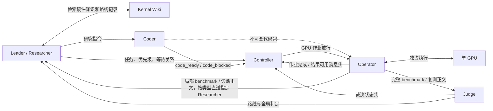

# KernelLab V1 单卡异步优化系统实现计划

**用途**：交给实现 agent 的设计规格与验收清单。  
**状态**：2026-11-18 讨论定稿。下文标为「初版默认」的数值和实现选择可配置。  
**配图**：[整体架构](./ARCHITECTURE.png)。图里的绿色箭头是 Operator 直接发送结果的路径。Controller 只收调度所需的消息头。Leader 一侧按任务类别继续细分到指定的 Researcher。完整评测和复测证据沿裁决路径直送 Judge。

## 1. 目标与范围

在最多一张物理 GPU 上开展多路线 kernel 优化。把 benchmark 分块、NCU 采集、上卡探针和晋升复测全部交给同一个 Controller 调度。显卡一次执行一个作业。CPU 和模型侧的研究、编码、纯 CPU 编译、报告解析和裁决可与在途 GPU 作业重叠。

Controller 的优先级有先后顺序：

1. **GPU 有合规的就绪任务时持续工作**。GPU 空闲时立即从当前允许执行的队列中选一项。
2. **在上述条件下尽可能让多名成员同时推进有效工作**。每次收到影响状态的新消息就重新打分、重算暂定计划。实际 GPU 放行发生在任务边界。

这是一次从零设计的独立运行时。沿用现有 KernelLab 的 GDN 评测、正确性和晋升协议。初版以独立入口接入现有可信评测工具，旧运行目录继续用对应的旧运行时和证据格式。先用模拟后端覆盖调度逻辑，再用单卡做真实验收。多 GPU、外部队列服务和新增评分协议留给后续版本。

## 2. 角色与所有权

| 角色 | 负责 | 交接 |
|---|---|---|
| **Leader** | 维护研究目标和路线优先级。内部由 Researcher 和 Kernel Wiki 组成。根据证据提出假设、诊断与实现指令。 | 给 Coder 发指令，给 Controller 登记任务、优先级和等待关系。 |
| **Coder** | 唯一写候选 kernel、探针和配套脚本的角色。按 Leader 指令交付不可变、可执行的代码包。 | 包一可读就发 `code_ready` 给 Controller。Operator 按包引用读取源码。实施受阻发 `code_blocked`。 |
| **Controller** | 调度状态、GPU 租约、作业放行、版本号和关闭信号的唯一写入方。跟踪预算、依赖、角色可用性和待测队列。 | 接收各角色的状态消息头，驱动队列重算。 |
| **Operator** | 固定执行程序。按 Controller 放行的作业启动、等待、停止和清理，采集可信结果。掌握 benchmark 测量协议与结果分流。 | 立即把作业状态头发给 Controller。按结果类型把正文直送 Leader 下的指定 Researcher 或 Judge。CPU 解析完成后同样分开报告状态和投递结果。 |
| **Judge** | 固定裁决流程。核验完整结果，按现有协议决定是否做晋升复测，提交每个候选的结论。 | 给 Controller 发裁决状态头，给 Leader 发完整结论，供更新 Wiki 路线记录。 |

源码父版本、当前上卡版本、路线最佳和全局最佳是四个独立字段。候选封存时已经有产物 ID 和父版本。真正获准进入 GPU 批次时才领取 `Vn` 这样的运行版本号。

下图是用于查验接口的文本关系：



## 3. Leader 与 Kernel Wiki

### Researcher 的工作循环

1. 收到局部 benchmark、诊断结果或 Judge 回执后，按需开启研究。短时间内到达的相关证据可以合为一次研究输入。每次开始研究**至少查一次 Wiki**。按目标 GPU、路线和证据检索，记录查询 ID。后续按需再查。
2. 分开记录观察、解释和预测。为少量互相竞争的假设写清适用 shape、已有证据、反证条件，以及下一步能采取的改动。候选假设包括局部调优和结构变化，例如数据布局、工作划分与数据流。
3. 使用能区分假设的最小实验。优先检查已有 benchmark、编译产物或报告。需要新证据时，选择源码改动、编译产物分析、定向 NCU 或探针。给 Controller 声明谁在等这份证据、拿到后可以开展哪项工作、预计属于哪类耗时。
4. 继续一条路线、开有明确新假设的支路或结束路线。新的诊断或 benchmark 到达后，把观察关联到原版本。复用旧版本证据时明确说明适用范围。

### Wiki 的两个部分

- **硬件知识插件**按 GPU 架构和工具链提供硬件信息、编译行为与调优经验。查询结果附来源、适用范围和版本。第一版提供一个与实际试验硬件匹配的插件和统一查询入口。
- **实验路线树**按「大方向 → 子方向 → 该方向的候选实验」组织。路线节点记录父节点、假设、状态、参照候选、停滞计数和可复用证据。实验记录包括源码父版本、改动、用例、结果、最终判断，以及在什么条件下值得重试。Wiki 所用的成绩和裁决从可信回执写入，Researcher 的解释单独保存。

每条可执行路线独立计数。同一轮以一个新候选的完整、可比评测结论为准。局部结果、采集和同产物重试均不计轮。编译和正确性失败进入单独的失败与修复计数。以该路线**最近一次确认有明显进步的版本**为参照。新路线从同口径完整测过的起点建立参照。累计改善超过配置的明显进步门槛时清零并更新参照，否则加一。连续三轮无明显进步就暂停该路线的新实验，兄弟路线继续。同一假设改名不清零。初版可用现有晋升门槛作为路线进展阈值的默认值，路线记录与正式晋升分别判断。

## 4. 指令、代码包与执行接口

### Leader → Coder

一条指令交付一个可以独立封存的产物。同一轮研究的多个指令共用 `research_id`，每条有独立的 `command_id`。

```json
{
  "head": {
    "command_id": "cmd-042",
    "kind": "write_probe",
    "research_id": "r-017",
    "direction_id": "register-pressure",
    "target": {"version_id": "V7", "artifact_id": "kernel-128"},
    "reply_to": "researcher"
  },
  "body": {
    "hypothesis": "短序列退化可能与寄存器溢出有关",
    "evidence_refs": ["eval-V7-W1", "wiki-lookup-017"],
    "instruction": "对 case-07 采集与该假设相关的观测",
    "deliverable": "固定探针入口与带用例 ID 的结果",
    "constraints": {
      "workload_ids": ["case-07"],
      "allowed_paths": ["probe/"],
      "preserve_target": true
    }
  }
}
```

指令类型为 `implement_kernel`、`write_ncu_capture`、`write_probe`、`write_compiler_analysis`。实现指令的 target 指源码父版本。诊断指令的 target 指被观察的冻结版本。Leader 可在发指令时用 `reply_to` 选定研究成员。Operator 依据可信任务定义中的结果类型与 `reply_to` 确定接收方。局部 benchmark 按 Leader 为该路线登记的研究接收方直送。完整 benchmark 和正式复测按固定规则直送 Judge。

### Coder → Operator / Controller

代码包包含源码、固定入口、清单和简短的约束对照。清单绑定 `command_id`、任务类型、目标产物身份、入口、文件摘要和可执行阶段。封装核对目标摘要、允许修改范围、固定用例、必需文件和入口。指令冲突、缺少输入或必须扩大改动范围时发 `code_blocked`，回到 Leader 修订。代码包发布后不可原地改写。

统一的 `start(package, inputs)`、`wait(handle)`、`stop(handle, reason)` 由 Operator 的固定运行器实现。Coder 实现包内入口。Operator 使用 Controller 指定的作业与配置运行，记录执行状态和结果，必要时取消并清理进程。停止操作应可重复执行。确认 GPU 上已提交的工作与进程完成清理后才能交卡。

运行权限由可信执行配置决定。复用现有候选执行隔离，评测脚本、参考输入和参照实现由平台提供，候选包只得到执行所需的输入与结果目录。候选代码的输出作为观测值或源码交付，正式成绩由可信评测路径重算。

### Operator 作业与证据

| 作业 | 执行要求 | 输出 |
|---|---|---|
| Benchmark 块 | 按冻结用例和计时协议做正确性检查和正式计时。 | 逐例配对结果与软件、GPU、候选身份。 |
| NCU 采集 | 在独占窗口单独运行。绑定目标版本、用例和实际编译特化，采集完成后释放 GPU。 | 原始报告。解析可交独立 CPU 作业，完成后另发可读事件。 |
| 探针 | 运行指定代码包和用例。需要 GPU 的探针经过同一放行入口。 | 对应假设的观测及目标身份。 |
| 编译与编译产物分析 | 能纯 CPU 完成的构建、IR/PTX/SASS 提取和比较在卡外执行。需要设备初始化或实际 GPU 工作的阶段按 GPU 作业调度。 | 编译产物、诊断结果或明确的不可用原因。 |
| 晋升或终评 | 以登记的版本、参照、运行配置执行已有独立复测协议。 | 完整、可核验的裁决证据。 |

Profiler 采集结果用于诊断。正式性能得分使用独立的 benchmark 数据。A/B/B/A 复测作为同一 GPU 租约内的作业执行，所有计时单元按冻结协议完成。

## 5. 消息协议与状态更新

调度事件使用统一消息头。公共字段为 `event_id`、`event`、`run_id`、`producer` 和时间戳。关联字段视类型携带 `command_id`、`direction_id`、`version_id`、`artifact_id`、`job_id`、`attempt_id`、作业类型、`status`、`receipt_id` 和结果类别。作业正常完成、正确性判定与 GPU 是否可交接分别表达。完整测量和分析内容随结果消息直接发送给接收角色。

| 事件 | 发送方 | Controller 据消息头更新的状态 |
|---|---|---|
| `task_proposed`、`task_waiting`、`priority_changed`、`task_withdrawn` | Leader 或研究成员 | 新任务、依赖、阻塞角色、预计工作量、候选优先级或取消。等待关系在开始等待时报告。 |
| `code_ready`、`code_blocked` | Coder | 代码包和实现资源状态。就绪包登记后重新检查依赖。 |
| `worker_state_changed` | 参与调度的执行成员 | 开始、空闲或阻塞，包含当前将做或正在做的工作。 |
| `gpu_job_finished` | Operator | 核对作业尝试，更新占卡与结果状态。`gpu_released = true` 需要确认清理。 |
| `result_ready` | Operator 或 CPU 阶段 | 更新证据可用状态和依赖。结果正文由产出侧直送指定 Researcher。 |
| `BENCHMARK_COMPLETE` | Operator 的可信汇总阶段 | 标记该版本完整评测可用。Operator 核对同源、同口径的完整用例覆盖，完整证据同时直送 Judge。 |
| `judge_result` | Judge | 根据状态头更新条件复测、裁决终态或全局最佳候选 ID。完整结论由 Judge 直送 Leader。 |
| `VERSION_CLOSED` | Controller | 发布当前版本的终态和关联回执 ID，解锁下一版上卡。 |

Operator 用同一个 `receipt_id` 关联两路消息。**调度通道**把完成头发给 Controller，用于判断 GPU 归还、依赖和下一项放行。**结果通道**把分类消息头以及结果正文或可读的产物引用直送指定 Researcher 或 Judge。证据先落盘，两个通道独立发出。Controller 无需等待结果接收方确认，也无需读取结果正文来放行 GPU。Researcher 确实获得输入并开工时，可通过自己的状态事件反馈。一个 benchmark 块的完成消息头示例如下：

```json
{
  "event": "gpu_job_finished",
  "event_id": "evt-081",
  "run_id": "run-001",
  "producer": "operator",
  "timestamp": "2026-11-18T20:00:00+08:00",
  "job_id": "job-081",
  "attempt_id": "job-081/1",
  "version_id": "V7",
  "artifact_id": "kernel-128",
  "kind": "benchmark_block",
  "block_id": "W2",
  "status": "completed",
  "gpu_released": true,
  "receipt_id": "receipt-081",
  "result_kind": "benchmark_partial"
}
```

同一次事件可以改变多个状态。Controller 在一次状态提交中处理去重、关联作业尝试及因果关系。重复事件、旧尝试回执和迟到结果不会重复计数、重新释放 GPU 或重开版本。依赖已失败时发送明确终态，解除无意义的等待。重启后先恢复已提交状态，再核对未决的 GPU 执行和清理结果。

## 6. Controller 调度与耗时模型

把任务表示成带版本、资源、输入依赖、输出和耗时估计的节点。依赖绑定实际产物或事件，例如「报告指标可读」「Coder 执行槽空闲」。Controller 只使用当前已登记的任务和阻塞关系预估下一步。

每次收到影响调度的新事件，立即更新状态并重算候选计划。GPU 正忙时只刷新暂定计划。GPU 归还时，选择最新状态下仍可放行的最高分任务。普通作业在边界切换，超时和取消走统一清理接口。

### 先筛选，再打分

1. 形成当前版本已就绪的 GPU 集合。检查输入、产物冻结状态、租约、任务与版本是否仍有效。
2. 可选诊断必须同时满足本版诊断预算和总预算，并给剩余必跑块及可能触发的复测留出时间。全新诊断用超时上限控制第一次试验占卡。
3. 把每个候选作业分别作为第一步，在**相同的时间窗口 H**内模拟。第一步后的 GPU 顺序用同一条默认规则补齐必需评测，CPU 与模型任务按依赖和执行槽开工。配置 H，首次实机试验可从两块的典型耗时开始校准。
4. 第一版所有成员等权。分数为窗口内各非 GPU 成员执行**已登记且输入可用的工作**的总秒数。同一成员同一秒最多计一次，Judge 与 Leader、Coder 同样计入。预期开始时刻要考虑 CPU 解析等待、资源容量与成员现有任务。
5. 用典型耗时推演。若可选诊断领先，再用偏慢的诊断与解析耗时重算。优势消失或挤压必需评测时，先补 benchmark。分数并列时优先预计更早补齐完整评测，再用稳定的就绪顺序打破平局。

`Score(plan) = Σ member_active_seconds(plan, H)`

例：剩余 W4 为 60 秒，探针占卡 20 秒、CPU 解析 10 秒。Leader 等探针做 50 秒分析，Judge 等完整评测做 50 秒工作。比较 100 秒窗口，先 W4 得 40 分，先探针得 70 分。若 Leader 已从另一份报告开始工作，立即撤掉该阻塞关系并重算。GPU 空闲且有合规的就绪任务时，Controller 立即选一项。尚未准备好的任务不占住 GPU 等待位。

### 耗时估计与更新

- 记录 `ready_at`、`started_at`、`gpu_released_at`、`result_ready_at`。排队时间、GPU 租约占用时间、后台处理时间分别计算。模型执行也记录起止。
- benchmark 按 GPU、测量协议和块建立历史。冷启动用启动开销与同类 shape 成本估计。NCU/探针按模板、用例数量和设备分组。编译和解析按工具链、缓存情况和报告类型分组。研究、实现、裁决按指令或任务类型分组，可用短／常规／长粗分。
- 样本不足时使用相近类别的历史与明确超时。样本积累后用中位数作典型估计，用较慢分位数（初版 P90）作预算与敏感性检查。超时样本单独记录为至少运行至超时，防止只统计成功样本。新设备、模型或协议换组估算。
- 预测用于选择和预留预算，真正的终止边界由版本期限、作业超时和清理回执决定。预留不足时优先保证已承诺的必需评测。

## 7. 版本边界、Judge 与整次停止

### 版本关闭

| 状态 | 进入条件与行为 |
|---|---|
| 执行中 | 放行时冻结候选和本版必需块、截止时间、诊断预算，并登记条件复测。本版只执行符合资格且获放行的 GPU 作业。 |
| 收尾中 | 必需 benchmark 块完成时关闭新增诊断入口，未上卡的可选任务标记跳过。Operator 汇总验证后将完整评测直送 Judge，并把完成头发给 Controller。预先登记的条件复测仍可按既定规则执行。失败或超时也进入收尾，取消在途工作并收清理回执。 |
| 已关闭 | 所有必需块和条件复测都有终态，GPU 已确认交还。只发一次 `VERSION_CLOSED`。迟到证据仍可归档并用于后续研究。 |

GPU 作业始终以版本为边界。`Vn+1` 可以提前研究、编码、纯 CPU 编译，只有 `VERSION_CLOSED(Vn)` 后才能开始占卡。仅做 CPU 判断的 Judge 工作能独立推进，若它的结论决定本版是否要复测，Controller 在关闭前等这个有时限的决定。若下一候选显式依赖某次裁决，还要等对应依赖满足。

跨路线选择按 Leader 的优先级、同级按就绪顺序。初版每条路线保留一个待测位，Leader 可明确替换。放行前重新检查假设、路线和候选是否仍有效。记录同级顺序、等待时长和被跳过次数，长期失衡通过 Leader 调整优先级。没有就绪候选但存在已登记的准备工作时，等待有明确期限的回执。

### 复用 Judge 规则

GDN 初版使用现有 `gdn-unified-v2` 协议、冻结的 FLA 基线、100 个固定 UUID 和四个 25 例块。所有结果绑定候选、分区、设备、测量协议和环境。Operator 调用可信评测器验证覆盖并从逐例数据重算几何平均加速比。Judge 核验 Operator 直接交付的完整评测证据。编译、数值、计时或覆盖不合格的证据按现有规则处理。

全局晋升按当前 KernelLab 的独立 ABBA 流程执行。有 incumbent 时以裁决冻结的 incumbent 为 A，候选为 B。复用现有全量正确性和配置的最小增益门槛（当前默认 `gain > 0.01`）。沿用已有首次留用规则与生产终评协议。终评针对冻结的保留版本，按现有三组独立计时块执行。避免在固定单卡上把若干候选的正式计时混到同一个独占作业里。

只在可信比较证据完整时提交一次晋升，提交时核对比较对象仍是当前有效的全局最佳。路线进展使用同口径完整结果对比路线参照。局部成绩、诊断报告、模拟作业和未完成评测不参与正式晋升。

### 异常与总预算

| 情况 | 初版默认 |
|---|---|
| 编译失败或数值错误 | 终止该候选评测，保留证据。修复需新指令和新产物，修复次数单独配置并封顶。 |
| 短暂的基础设施故障 | 同冻结产物和输入允许重试一次，用新尝试 ID，沿用原有计时与预算。旧尝试成绩不并入新结果。 |
| 块缺失、重复或身份不同 | 保存有效块供研究。拒绝完整评测与晋升，版本到终态后继续处理其余合规工作。 |
| 可选诊断超时、缺指标或失败 | 返回失败或不可用，解除依赖并记已花成本，由 Leader 决定后续。 |
| 在途作业取消、进程崩溃或 GPU 清理未确认 | 等 Operator 的清理确认。无法确认时停止正常放行，保留已验证证据。 |
| 无任务可运行 | 区分有明确期限的在途依赖、依赖失败与正常无后续。到期收尾或返回明确阻塞原因。 |
| 版本关闭后收到旧证据、作业或重复回执 | 证据可归档，旧版 GPU 任务保持关闭。状态、评分与 GPU 交接按事件和尝试 ID 去重。 |
| 整体预算将耗尽 | 冻结新的版本接纳。保留当次收尾和正式终评需要的预算，已有作业按协议结束或取消。 |

新 run 冻结墙钟、GPU 与模型预算和每版诊断预算。新增路线消耗同一总预算。接纳新版本前检查剩余预算是否足以支付必需评测和条件复测的预留。预算到期或所有路线已止、无有效的准备任务时结束，返回已验证最佳、候选和路线停止原因。没有候选晋升时返回已验证基线。终评失败或未完成时明确标记验证层级。

## 8. 实现顺序

1. **协议与状态机**。定义事件、任务、工件、版本、裁决和预算结构，用本地持久存储和固定时钟建立可重放模拟。实现一次性关闭、去重及恢复。
2. **执行器与固定评测**。移植或封装可信 GDN benchmark、分块、晋升和终评接口。实现 Operator 的启动、停止、等待、GPU 交接、结果落盘以及 CPU 与 GPU 作业拆分。
3. **动态 Controller**。先跑通有就绪任务即放行的基线，再加已知依赖推演、成员秒数评分、耗时历史与偏慢检查。每次选择记录候选任务、分数、排除理由和状态序号，确保事后能解释调度。
4. **Leader、Wiki 与 Coder**。先用固定脚本或模拟模型接入真实消息接口，再接 Researcher、硬件插件与路线树。完成 Wiki 首查、可核对指令、代码包封存和跨路线优先级。
5. **验收与真实单卡对照**。先验收机制正确性，再接固定模型与生产 GPU。保持评测协议一致，比较整轮反馈、分块反馈加先到先服务、分块反馈加动态打分。

建议实现 agent 优先读取这份规格，然后核对仓库中可复用的 [现有异步设计](../kernel_lab/docs/ASYNC_WORKFLOW.md)、[架构职责](../kernel_lab/docs/ARCHITECTURE.md)、[评测判定](../kernel_lab/evaluation/acceptance.py)、[运行配置](../kernel_lab/configs/default.json) 和 [历史时间数据](../简报/KernelLab-分析报告-定稿-20261104.md)。这些文件提供协议和测量依据，新运行时自己的调度以本计划为准。

## 9. 最小验收清单

| 场景 | 必须观察到 |
|---|---|
| W1 返回，W2 已就绪 | Controller 只收到 W1 的完成头。Operator 将 W1 正文直接发给该路线指定的 Researcher。W2 与研究重叠，已上卡的候选保持冻结。 |
| 多类结果并发返回 | NCU、探针和编译分析按类别与 `reply_to` 直达对应 Researcher。完整评测与复测证据直达 Judge。Controller 的状态事件中无结果正文。 |
| 探针可用，同时有必跑块 | Leader 等证据时探针可胜出。撤掉等待关系或用偏慢耗时重算后，选择可改回 benchmark。 |
| NCU 采集与解析分离 | GPU 先归还，下一项 GPU 作业可启动。只有解析结果到达才解除依赖该结果的研究任务。 |
| 完整块、候选冲突与可选复测 | 混源、缺例和重复 UUID 无法晋升。先完整评测，必要时复测，再关闭版本。 |
| 下一版已经准备就绪 | 当前版本关闭前 GPU 不给下一版。关闭后从合规就绪候选按 Leader 优先级选取。 |
| 迟到、重复、超时、取消、重启 | 无重复放行、无重复晋升、无串版本。GPU 未确认清理时保持阻断。 |
| 路线三轮停滞与重新进步 | 无提升、无提升、有明显提升、无提升得到 1、2、0、1。连续三次无明显提升只暂停对应路线。 |
| 查询与指令约束 | 每轮研究有 Wiki 查询凭据。越界改动拒绝就绪，目标与产物身份可追溯。 |
| 整体预算或无后续 | 终态明确，交付最佳已验证版本和证据，保留失败原因。 |

对照报告记录首份可行动证据用时、成员和 GPU 重叠时长、GPU 租约占用和空闲时间、同预算内最佳验证成绩、达到同一验证成绩的墙钟、GPU 秒数和模型成本。只比较相同协议下的结果。模拟验收证明执行顺序和状态规则，性能结论以真实单卡数据为准。

## 附录 · 架构图生成提示词

架构图用内置图像生成工具生成。下列是实际使用的提示词：

```text
Use case: infographic-diagram.
Generate a single, high-resolution, landscape 16:9 technical architecture diagram titled “KernelLab V1 · 单卡异步优化”. Chinese simplified labels plus the specified English role names, large legible type, white background, well spaced editorial technical drawing, simple rectangular nodes, short orthogonal arrows. Navy for execution, teal for evidence, orange for control. No extra text, no decorative illustrations.

Use two broad horizontal lanes. Upper lane labelled “CPU / Agent” contains, from left to right, a large “Leader” group (inside: “Researcher” and “Kernel Wiki”, with Wiki subtitles “硬件插件” and “实验路线树”), “Coder”, and “Judge”. Show Leader → Coder as “研究指令”, and Judge → Leader as “裁决回执”. Lower lane contains “Controller” to the left of “Operator”, and a single device block below Operator labelled “单张 GPU”. Inside Controller show “事件更新 → 重新打分 → 放行”. Draw Controller → Operator as “放行作业”, Operator → Controller as “作业回执”, and Coder → Controller as “代码就绪”. Operator → 单张 GPU is the only GPU dispatch path. Show the GPU holds one job at a time, with three unconnected chip labels “Benchmark 分块”, “NCU 采集”, “探针”. These are alternative job types, with no arrows between the chips. Show evidence arrows from Operator to Leader (“局部结果 / 诊断”) and from Operator to Judge (“完整评测”), never from Judge to Operator. Within Leader, Researcher looks up Kernel Wiki. Keep all arrowheads and their endpoints easy to distinguish, route the evidence arrows around other boxes, never merge arrows of different meaning.

At the very bottom add a small separate flow strip “Vn → VERSION_CLOSED → Vn+1” and caption “GPU 作业按版本收尾 · 研究与编码可提前”. This strip is a version gate rather than a connection to any particular role. Use only the quoted labels. Omit ornamental marks and logos. Keep the whole diagram on one balanced canvas, with ample left and right margins and no crossing over text.
```
